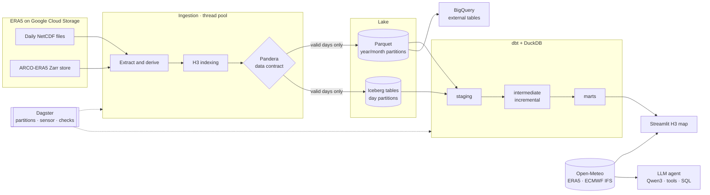

# ERA5 Geospatial Lakehouse

[](../../actions/workflows/ci.yml)

**The weather of any point on Earth, hour by hour since 1940**, from ERA5, the climate reanalysis of ECMWF. It is
ingested at scale into a lakehouse, explored like Weather Underground on a map of H3 hexagons, and asked in plain
language to an open LLM that answers with SQL on the data, not from memory.

<!-- Live demo: add the link of the Streamlit Community Cloud app here -->
<!--  -->

## Why

Weather stations are sparse, unevenly spread and archived in many places. ERA5 covers the whole planet every hour
since 1940 on a 28 km grid, combining satellites, stations, balloons and a weather model into one consistent record.
But it comes as about **25 million values per variable and day**, in NetCDF and Zarr files on cloud buckets, out of
reach of a quick question. This project makes it usable in two ways:

- a **data platform** that ingests it, checks it and models it for analytics: anomalies, heatwaves, extreme rain;
- an **app** that gives the weather of any place on any day on demand, with an **agent** that answers questions on it.

## What I found

- **Ingestion 18 times faster:** from 68.8 to 3.8 s per variable-day, with parallel workers and the Zarr store
  ([Performance](#performance)).
- **Time zones are a trap:** Open-Meteo gives every hour of an answer with the UTC offset of the day it is asked, so
  the hours of the other season came one hour off in New York. The app asks UTC hours and converts each one with the
  time zone database, which makes local days of 23 and 25 hours when the clocks change.
- **A grid cell is not a station:** New York's values differed from Weather Underground's because its station, KSWF,
  is Stewart airport, 90 km north, and because the last day of ERA5, a UTC day, is incomplete west of Greenwich. The
  app compares the same place and keeps complete local days only.
- **An LLM picks queries well and handles numbers badly:** the agent answers 20 of 23 evaluation questions, and each of
  its guards comes from a failure. It made up numbers from a partial result, cut a result with `LIMIT`, followed
  DuckDB's advice to use `ANY_VALUE`, rounded 7.962 to 7.9, and gave the rain of 15 Januaries as the mean of one
  ([Weather agent](#weather-agent)).

<!--
| The weather of a place: day, month and year | The agent: an answer and how it got it |
|---|---|
|  |  |
-->

## What's inside

- **Ingestion** in Python: daily NetCDF files or the analysis-ready Zarr store, parallel workers, derived variables,
  **H3** geospatial indexing and a **Pandera data contract** gating every write.
- **Lake** of Hive-partitioned **Parquet** datasets or **Apache Iceberg** tables, with idempotent day overwrites.
- **dbt + DuckDB** models: daily H3 cell weather, regional rollups, climatology, temperature anomalies,
  **heatwave** and **extreme precipitation** detection, with 29 data tests.
- **Dagster** orchestration: daily partitioned assets, dbt models as assets, data contract and dbt tests as asset checks,
  and a sensor launching each day when ERA5 publishes it.
- **Streamlit + Leaflet** map of the marts on H3 hexagons, and the weather of any place since 1940 on demand.
- **Weather agent**: an open LLM (Qwen3, served by Ollama on a laptop GPU) that answers questions in plain language
  by calling tools and writing SQL, with an evaluation set comparing models.
- **Docker**, **Terraform** (Cloud Run job, Cloud Scheduler, GCS, BigQuery external tables) and **GitHub Actions** CI.



## Contents

- [Performance](#performance)
- [Quick start](#quick-start)
- [Ingestion](#ingestion)
- [Transformation: dbt + DuckDB](#transformation-dbt--duckdb)
- [Orchestration: Dagster](#orchestration-dagster)
- [Dashboard](#dashboard)
- [Weather agent](#weather-agent)
- [Queries](#queries)
- [Deployment](#deployment)
- [Development](#development)
- [Project structure](#project-structure)

## Performance

The ingestion of 2 variables over 4 days of April 2022 (8 variable-days) from the public bucket, on a laptop (Intel
Core Ultra 7 255HX, 32 GB of memory), measured with [benchmarks/ingestion_benchmark.py](benchmarks/ingestion_benchmark.py)
([results](benchmarks/results.jsonl)). The times depend on the network: each variable-day reads about 50 MB.

| Run | Seconds per variable-day | Peak memory |
|---|---|---|
| Original code | 68.8 | 3.2 GB |
| NetCDF files, 1 worker | 11.3 | 2.6 GB |
| NetCDF files, 4 workers | 4.8 | 5.3 GB |
| NetCDF files, 8 workers | **3.8** | 9.8 GB |
| Zarr store, 1 worker | 11.2 | 2.5 GB |
| Zarr store, 4 workers | 4.2 | 5.9 GB |

## Quick start

Requirements: [uv](https://docs.astral.sh/uv/) (it installs Python 3.12 and the locked dependencies). The ERA5 bucket is
public, no Google Cloud credentials are needed.

```bash
uv sync

# Ingest one week of July 2022 (~2.3 GB of Parquet)
uv run python src/main_script.py --start_date 20220701 --end_date 20220707 --workers 4

# Build the dbt models and run their tests (DuckDB warehouse in output/warehouse.duckdb)
cd transform && uv run dbt build && cd ..

# Explore any place, and the marts on the map: http://localhost:8501
# (the Ask the weather page needs Ollama and a model: ollama pull qwen3:8b)
uv run streamlit run src/dashboard/app.py

# Or orchestrate everything with Dagster: http://localhost:3000
uv run dagster dev -m orchestration.definitions -d src
```

## Ingestion

```bash
uv run python src/main_script.py --config config/config.yaml --start_date YYYYMMDD --end_date YYYYMMDD
```

Each **variable-day** goes through the same steps, in [src/utils/pipeline.py](src/utils/pipeline.py):

1. **Extract** the 24 hourly grids of the variable, or of its inputs for a derived variable, from the selected source:
   - `netcdf`: the daily NetCDF file of each field (~50 MB), downloaded with one request and decoded in memory;
   - `zarr`: the [ARCO-ERA5](https://github.com/google-research/arco-era5) analysis-ready Zarr store, fetching only the
     24 chunks of the day, concurrently.
2. **Clean** the values with the logic of the variable, and store them as `float32` (ERA5 is packed on 16 bits).
3. **Index** each grid point with its [H3](https://h3geo.org) cell. The grid never changes, so the point-to-cell lookup is
   computed once, cached on disk (`h3_lookup_path`) and shared by the workers.
4. **Validate** the day against its [data contract](src/utils/quality.py) (Pandera), collecting every violation:
   values within the plausible range of the variable, a complete grid with 24 hourly values, at most 1% of missing
   values, well-formed H3 cells. A day that fails is not written.
5. **Write** the day to the sink:
   - `parquet`: Hive-partitioned datasets, `<output_path>/<variable>/year=YYYY/month=MM/<date>_<variable>.parquet`,
     written to a temporary file and renamed, so an interrupted run never leaves a truncated file;
   - `iceberg`: Apache Iceberg tables `era5.<variable>` partitioned by day, where writing a day replaces its partition
     in one atomic commit. A local SQLite catalog is used by default, any pyiceberg catalog can be configured.

Variable-days run on a pool of worker threads (`--workers`): downloads, decoding and Parquet encoding release the GIL.
Days already written are skipped, so a run can be resumed or scheduled over a sliding window of dates. A variable-day
that fails (missing data, transient error after retries with exponential backoff, contract violation) is logged and does
not stop the others; the exit code is `1` if any failed.

### Command line

| Argument | Description |
|---|---|
| `--config` | YAML configuration (default: [config/config.yaml](config/config.yaml)), relative paths resolved against its directory |
| `--start_date`, `--end_date` | Inclusive range, `YYYYMMDD` or relative to the current UTC day, e.g. `today-12` (default: year 2022) |
| `--variables` | Variables to process (default: `variables` of the configuration) |
| `--workers` | Variable-days processed in parallel, each holding ~1.5 GB of memory (default: `workers`) |
| `--source` | `netcdf` or `zarr` (default: `source`) |
| `--sink` | `parquet` or `iceberg` (default: `sink`) |
| `--overwrite` | Reprocess the days already written |
| `--skip_queries` | Do not run the sample [queries](#queries) at the end |
| `--log_level` | `DEBUG`, `INFO`, `WARNING` or `ERROR` |

### Variables

ERA5 variables differ in nature, so each one has its own logic in [src/utils/variables.py](src/utils/variables.py).
Derived variables are computed from several ERA5 fields.

| Variable | Column | Stored unit | Computed from | Cleaning | Aggregates (reported unit) |
|---|---|---|---|---|---|
| `total_precipitation` | `tp` | m, hourly accumulation | | below 1e-8 m set to 0 | `sum` (mm) |
| `2m_temperature` | `t2m` | K | | outside 150-350 K masked | `mean`, `min`, `max` (°C) |
| `10m_wind_speed` | `ws10` | m/s | u and v wind components | outside 0-120 m/s masked | `mean`, `min`, `max` |
| `2m_relative_humidity` | `rh2m` | % | temperature and dewpoint (Magnus formula) | clipped to 0-100 % | `mean`, `min`, `max` |

The stored values keep the ERA5 units; conversions apply to the aggregated values. A sum of temperatures is meaningless
and is rejected. To add a variable, add a `VariableSpec` to the registry with its source fields, cleaning, valid range
and aggregations, then list it in `variables`.

### Configuration

Besides the command line defaults, [config/config.yaml](config/config.yaml) holds the bucket and Zarr store, the
`storage_options` of the GCS filesystem (anonymous access), the output paths, the H3 resolution, the Iceberg catalog,
`max_retries`, `max_null_fraction` of the data contract, the first day of the Dagster partitions and the sample queries.

## Transformation: dbt + DuckDB

The [dbt project](transform/) builds a DuckDB warehouse from the lake. Its sources read the Parquet datasets
(`read_parquet` with Hive partitioning) or the Iceberg tables (`iceberg_scan`) depending on `ERA5_FORMAT`, and the
[DuckDB H3 extension](https://github.com/isaacbrodsky/h3-duckdb) handles the cell geometry and hierarchy.

| Layer | Model | Content |
|---|---|---|
| staging | `stg_era5__temperature`, `stg_era5__precipitation`, `stg_era5__grid_points` | Hourly values in °C and mm, grid points and their cell |
| intermediate | `int_era5__daily_cell_temperature`, `int_era5__daily_cell_precipitation` | Daily statistics per H3 cell (incremental) |
| marts | `fct_daily_cell_weather` | Daily weather per cell: temperature mean/min/max/range, precipitation, wet day (incremental) |
| | `dim_h3_cell` | Cell center, area and region of the rollup |
| | `agg_daily_region_weather` | Area-weighted rollup to H3 resolution 3 regions (~12,000 km²), light enough for a world map (incremental) |
| | `fct_monthly_cell_climatology` | Baseline per cell and calendar month: means, variability, 90th percentile of the maximum temperature |
| | `fct_daily_temperature_anomaly` | Daily anomaly and standardized anomaly against the baseline |
| | `fct_heatwave_events` | Runs of 3+ consecutive days above the 90th percentile of the cell and month (gaps and islands) |
| | `fct_extreme_precipitation_days` | Wet days above the 95th percentile of the wet days of the cell (R95p) |

The incremental models rebuild a window of days: the days selected with
`--vars '{start_date: 2022-07-01, end_date: 2022-07-31}'` (what Dagster passes for its partitions), otherwise the days
after the last one built minus a lookback of 3 days, to pick up late data. The climatology and the extreme events are
meaningful with several years of data; the baseline years and the thresholds are dbt vars.

```bash
cd transform
uv run dbt build                       # models and the 29 data tests
uv run dbt docs generate && uv run dbt docs serve   # documentation and lineage graph
```

The paths come from the environment: `ERA5_LAKE_PATH` (default `../output`), `ERA5_FORMAT` (`parquet` or `iceberg`),
`ERA5_ICEBERG_WAREHOUSE`, `DUCKDB_PATH`.

## Orchestration: Dagster

[src/orchestration](src/orchestration/) defines the platform as software-defined assets:

- one **daily partitioned asset per ERA5 variable**, keyed like the dbt sources (`era5/2m_temperature`), with retries and
  a concurrency pool; the data contract is a **blocking asset check** and the run metadata carries the row count,
  missing share, range and the duration of each stage;
- the **dbt models as assets**, partitioned by day too: a run builds the days of its partitions and a backfill of many
  days runs dbt once over the range; the dbt tests become asset checks;
- the `era5_daily` job and a **sensor** that launches each new day as soon as ERA5 has published all the fields it
  needs. ERA5 comes out about 6 days after real time, so a fixed schedule would run before the data exists.

```bash
uv run dagster dev -m orchestration.definitions -d src
```

`ERA5_CONFIG` selects the configuration file. [dagster.yaml](src/orchestration/dagster.yaml) limits the concurrent
ingestion steps; copy it into `$DAGSTER_HOME`.

## Dashboard

The dashboard, [src/dashboard/app.py](src/dashboard/app.py), has two pages: **Weather**, the explorer, and **Ask the
weather**, the [agent](#weather-agent). The explorer, [explorer.py](src/dashboard/explorer.py), maps the marts on H3 hexagons:
mean and maximum temperature, precipitation,
temperature anomalies, heatwaves and extreme precipitation, on the world regions or on the cells of an area, with the
daily KPIs and the global mean temperature over time. It reads the warehouse through short-lived read-only connections,
so it never blocks the dbt runs.

A **place**, searched by name (e.g. `Milano`, geocoded with OpenStreetMap [Nominatim](https://nominatim.org)), typed
as coordinates (`45.46, 9.19`) or clicked on the map, gets its weather on **any day since 1940**, Weather Underground
style, with nothing to ingest: the sky of the day with its icon (from the WMO weather codes of the hours: a thunderstorm
by daylight, the precipitation of a wet day, fog, else the daylight cloud cover), its high, low, average,
precipitation, sunshine, humidity and wind (mean speed at 10 m, dominant direction from the vector sum of the
hours, strongest gust); its month, with the averages of the highs, lows and
means, the extremes, total precipitation, wet days, mean wind, strongest gust and a table of every day; its year,
with the same statistics month by month; and the hourly temperature, precipitation and wind, with arrows pointing
where it blows, in local time. Its tabs open on the day, then come its month and its year. Its H3 cell is outlined on the map, with its **mean altitude** and range, sampled at 49 points of the Copernicus
90 m elevation model (Open-Meteo elevation API).

The map, [maps.py](src/dashboard/maps.py), is Leaflet through streamlit-folium, which gives the point of a click: a
click anywhere picks that point. It replaced deck.gl, which tells Streamlit the clicked object only, so the map was
clickable through invisible hexagons, and a click far from the place took a first click to get there. The hexagons
stay for their look and the area of the place: its cell and a patch of 331 around it, from 138 to 2.8 km across
(resolutions 3 to 7, 2.8 km by default) with the **Hexagons** control, which also sizes the area of its altitude (its
weather stays the 28 km ERA5 grid); a light grid on the world or an area otherwise. The basemap is CARTO's, drawn by
MapLibre from its vector tiles: its raster tiles now print "API KEY REQUIRED" across the map. Only a click reruns the
page, and the map is drawn again only when its content changes, so a tab or a day keeps the view; **Recenter** goes
back to the place. The theme is in [.streamlit/config.toml](.streamlit/config.toml). On phones, narrower than 640 px,
the map is shorter, one finger scrolls the page over it and two move it, and the tiles come two a row. The sidebar, with the
search, starts open there too, and closes once a place is chosen, to show its weather. The page speaks plainly: the models are named in the credits only. It comes on demand from the ERA5 archive of
[Open-Meteo](https://open-meteo.com) (`models=era5`, the 0.25° grid of the pipeline; free for non-commercial use,
CC BY 4.0): Open-Meteo stores ERA5 as time series, so a month of a place takes one small request, where the ARCO-ERA5
Zarr store holds one global field per hour. ERA5 comes about five days behind real time: the days it has not
published yet, and the **forecast of the next two weeks**, come from the operational model of the same centre,
ECMWF IFS (9 km, `models=ecmwf_ifs` of the Open-Meteo forecast API), ERA5 winning where both have a day or an hour.
Every day and hour carries its source (ERA5, ECMWF IFS or Forecast), shown as Historical, Recent or Forecast in the
tables, a badge and lighter bars;
the statistics of a month or a year leave the forecast out. Both need internet access. The map shows the ingested days only, zoomed on
the place when one is searched. Zoomed-in maps are drawn on resolution 4 cells: the 0.25° grid is sparser
than the resolution 5 cells, half of which hold no grid point at mid latitudes.

```bash
uv run streamlit run src/dashboard/app.py   # DUCKDB_PATH selects the warehouse of the map
```

## Weather agent

[src/dashboard/agent.py](src/dashboard/agent.py) answers questions about the weather of any place in plain language,
such as *"Quanti giorni sopra 30 °C ha avuto Milano nel luglio 2022?"*, with an open model served by
[Ollama](https://ollama.com) on the laptop GPU: by default **Qwen3 8B** (Apache 2.0, 5.2 GB at 4 bits), which calls
tools reliably and fits in 8 GB of GPU memory with an 8,192-token context. The model never does the arithmetic: it
picks the tools and writes SQL, and the tools compute every number from the same sources as the explorer.

| Tool | What it does |
|---|---|
| `query_days` | Runs a DuckDB `SELECT` on the table `days` of a place, up to 31 years: highs, lows, means, precipitation, sunshine, humidity, wind, weather code and source of each day; and on the view `months`: the means and totals of each month of each year |
| `query_hours` | Runs the same on the table `hours`, up to a year, in local time |
| `cell_altitude` | Gives the mean, lowest and highest altitude of the H3 cell of a place |
| `find_place` | Geocodes a name with Nominatim: up to 3 matches, to choose among places of the same name |

The data tools take the place by name or coordinates, geocode it themselves (cached, as Nominatim allows one request a
second) and return the place they found with the rows, so that a question takes two model turns: a query, then the
answer. The SQL runs in an in-memory DuckDB with `enable_external_access = false`: one `SELECT` on the table of the
tool, with no files and no network. A failed tool call goes back to the model as its result, so that it fixes the
query, within 8 steps.

Three guards come from a failure. Asked for the mean temperatures of the last 10 years in Milan, the first version of
the agent answered about 5 °C a year, where ERA5 gives 14 to 16 °C. Its queries were limited to 5 years, so the model
queried each year's daily rows, saw only the first 40 of each (1 January to 9 February), filled its context, and
made up the numbers. Now:

- **No partial results:** a result of more than 40 rows or 4,000 characters is refused, with the advice to aggregate
  in SQL (`AVG` over the period, `GROUP BY year(date)`): a model shown part of the rows computes from the part.
- **No silent truncation:** the agent estimates the tokens of the conversation and stops before the 8,192-token
  context overflows, where Ollama would drop its beginning, the instructions and the question, without a word.
- **Unverified numbers are flagged:** every number of an answer must appear, rounded to one decimal or to units, in
  the question or in the data the agent read. The others were computed or made up by the model, and the page shows them
  in a warning.
- **Values come rounded:** the tools give values to one decimal, for the model to copy. It reads numbers as text and
  rounds them badly: given 7.962 °C, the mean high of January in Milan from 2010 to 2025, it wrote 7.9 °C, and the
  check above flagged it.

The same question now takes one query, `SELECT AVG(temperature_mean_c) FROM days` over 2016 to 2025, and gets 14.8 °C.

Another failure shaped the tables. Asked the mean high, low and precipitation of each month over 15 years in Lugano,
Qwen3 8B summed the days of each month: the 15 Januaries together, 991.9 mm instead of 66.1. The prompt showed the
right query, a sum divided by the years, and the model had copied it when asked the precipitation alone. Instead of
more instructions, `query_days` now has the view `months`, the totals of each month of each year computed by the code:
the mean of each month is an `AVG`, the query a model writes anyway. DuckDB computes the view only for the queries
that read it, from the days already loaded.

```bash
winget install Ollama.Ollama        # or the installer of ollama.com; then:
ollama pull qwen3:8b
uv run python src/dashboard/agent.py "Quanta pioggia è caduta a Valencia il 29 ottobre 2024?"
uv run streamlit run src/dashboard/app.py   # the Ask the weather page
```

**Ask the weather**, the second page of the dashboard, is a chat with the agent. The sidebar chooses the model (any
Ollama model that calls tools) and thinking, and shows its latest evaluation score. Follow-up questions are answered
with the earlier turns, and **How I got it**, above each answer, shows every tool call with its SQL and its result;
numbers the data did not give get a warning under the answer.
`AGENT_MODEL` and `OLLAMA_HOST` set the default model and the server, `AGENT_MODELS` the models offered (by default all
those of the server). Without Ollama the page says how to start it; a host without a GPU gets the model from
[Ollama Cloud](#streamlit-community-cloud).

### Evaluation

[src/dashboard/agent_eval.py](src/dashboard/agent_eval.py) asks 24 questions in Italian about 18 places and grades the
answers by their numbers. The questions cover counts, extremes, totals, means, two periods at once, an hour, an
altitude, tomorrow's forecast and long periods: the annual means of 10 years, a 30-year climate normal, the wettest
month of a year, and the mean high and precipitation of each month over 11 and 15 years. The expected numbers are computed by code at each run, from the same data, at the
coordinates the agent queried. They follow the forecast, and they follow the point: Open-Meteo corrects the
temperature of a grid cell for the altitude of the point, and Nominatim can give a city and its region, 15 km apart,
under the same name. An answer passes when the agent read the data of one of the geocoder's matches and the answer
gives every expected number within its tolerance (counts exact, values ±0.15, totals ±1 %). Otherwise it fails for
*no data*, *wrong place* or *wrong value*, or *error* when Ollama or the data were out of reach, asked again after a
minute. The results, with the unverified numbers of each answer, accumulate in
[benchmarks/agent_eval.jsonl](benchmarks/agent_eval.jsonl).

A run asks decades of hourly data, which Open-Meteo counts as about 1,800 of its free calls (5,000 an hour, 10,000 a
day): five runs in an hour used them up, and the dashboard got refused too. The final ERA5 days a run loads, older
than three months, are now kept in `benchmarks/.cache/` for the next runs, and a refusal says why, at once.

```bash
uv run python src/dashboard/agent_eval.py --model qwen3:8b --model qwen3:4b --model gpt-oss:20b
uv run python src/dashboard/agent_eval.py --report     # the latest result of each question, by model
```

| Agent | Right answers | Failures | Tool calls per answer | Seconds per answer |
|---|---|---|---|---|
| First version, Qwen3 8B (18 questions) | 17 of 18 | 1 wrong value | 2.1 | 6.9 |
| Current, Qwen3 8B (`qwen3:8b`, no thinking) | **20 of 23** | 3 wrong values | 1.2 | 7.1 |

Seconds measured on an RTX 5060 Laptop GPU (8 GB) at full power. With a weak charger the GPU stays at its lowest
power state, and the same answers take ten times longer. The first version failed on New York: asked for the mean
temperature of January 2024, the model wrote a query that DuckDB refused, then fetched the 31 daily means and averaged
them itself, 1.9 °C instead of 2.2 °C.

The monthly questions come from a failure of the current agent. Asked for the mean highs, lows and precipitation of
each month in Lugano from 2015 to 2025, the model grouped by month of each year (132 rows), was refused, followed the
advice of the refusal to keep the rows it needed with `LIMIT`, and gave the 12 months of 2015 as the means of 11
years. The refusal now advises to aggregate by month of the year, the prompt shows SQL recipes (a mean over the
period, values by year, each month of the year over several years, the day of the highest value), and `ANY_VALUE`,
which DuckDB itself suggests for a column left out of `GROUP BY`, is refused: it takes an arbitrary row.

The failures left are of choice, not of arithmetic, and the check of unverified numbers cannot see them, as the
numbers are in the data: the daily mean column for the mean high, one day of January for its mean, an empty forecast
filtered by the wrong source (since fixed in the prompt). Qwen3 8B is unstable on them: each revision of the prompt
fixes some questions and breaks others. The prompt was revised while looking at these failures, so the scores are
optimistic for new questions. Next to measure: thinking (`--think`), and the other models pulled,
`--model qwen3:4b --model gpt-oss:20b`.

## Queries

The `queries` of the configuration file run at the end of the ingestion, on either sink. Each query has a `name`, the
`variable` it targets and any combination of the following filters:

| Key | Description |
|---|---|
| `start` / `end` | Date range in `YYYY-MM-DD` format, both days included (every hour of the end day is kept) |
| `h3_index` | H3 cell identifier |
| `bbox` | `{lat_min, lat_max, lon_min, lon_max}`, with longitudes in the ERA5 0-360 convention |
| `point` | `{latitude, longitude, tolerance}`: grid points within `tolerance` degrees (default 0.01) |
| `aggregate` | One or a list of the aggregates supported by the variable: the values are logged in the reported unit instead of saving the rows |

Queries without `aggregate` save their rows to `<query_output_path>/<name>.parquet`. Unknown keys and aggregates not
supported by the variable raise an error, a query returning no rows logs a warning, and queries on a variable not
processed yet are skipped.

```yaml
queries:
  - name: zurich_april_temperature
    variable: 2m_temperature
    point: {latitude: 47.25, longitude: 8.5, tolerance: 0.01}
    start: "2022-04-01"
    end: "2022-04-30"
    aggregate: [mean, min, max]
```

The datasets can also be queried directly, with PyArrow or DuckDB:

```python
import pyarrow.dataset as ds
from utils.query_runner import PARTITIONING

dataset = ds.dataset("output/total_precipitation", format="parquet", partitioning=PARTITIONING)
df = dataset.to_table(filter=(ds.field("month") == 4) & (ds.field("h3_index") == "85032097fffffff")).to_pandas()
```

## Deployment

### Docker

The [Dockerfile](Dockerfile) builds three images with uv from the lockfile: `runtime` (the ingestion command line),
`platform` (Dagster, dbt with a prebuilt manifest and the DuckDB extensions, the dashboard) and `test`.

```bash
docker compose run --rm pipeline --start_date 20220701 --end_date 20220707 --workers 4
docker compose up dagster-webserver dagster-daemon dashboard   # :3000 and :8501
docker compose run --rm tests
```

### Streamlit Community Cloud

The dashboard runs on [Streamlit Community Cloud](https://share.streamlit.io) from this repository: main file
`src/dashboard/app.py`, Python 3.12. It installs [src/dashboard/requirements.txt](src/dashboard/requirements.txt), the
dashboard alone. The explorer needs nothing more. The agent gets its model from [Ollama Cloud](https://ollama.com), the
same open models served on its GPUs, with a key of an Ollama account. In the secrets of the app, which Streamlit sets
as environment variables:

```toml
OLLAMA_HOST = "https://ollama.com"
OLLAMA_API_KEY = "<key of ollama.com/settings/keys>"
AGENT_MODEL = "gpt-oss:20b"
AGENT_MODELS = "gpt-oss:20b"
AGENT_QUESTIONS_PER_HOUR = "20"   # to all the visitors together: they share the quota of the key and of Open-Meteo
```

### Google Cloud with Terraform

[infra/terraform](infra/terraform/) deploys the ingestion next to the ERA5 bucket (us-central1, no egress cost):

- a **GCS bucket** for the lake and an **Artifact Registry** repository for the image;
- a **Cloud Run job** running the pipeline, the bucket mounted with Cloud Storage FUSE, over a sliding window
  (`today-12` to `today-6`): days already written are skipped, so each execution also catches up on missed days;
- a **Cloud Scheduler** trigger running the job every day, with dedicated least-privilege service accounts;
- **BigQuery external tables** over the Hive-partitioned Parquet, queried in place.

```bash
cd infra/terraform
cp terraform.tfvars.example terraform.tfvars   # project and bucket names
terraform init -backend-config="bucket=<state-bucket>"
terraform apply
```

## Development

```bash
uv run pytest                 # unit and integration tests (the dbt models and the Dagster job on synthetic data)
uv run pytest -m "not integration"   # unit tests only, a few seconds
uv run ruff check . && uv run ruff format --check . && uv run mypy
uv run pre-commit install     # ruff, mypy and the lockfile check on every commit
```

The tests never download from GCS: they use synthetic grids, an in-memory filesystem, a local Zarr store and a local
Iceberg catalog. The integration tests ingest a two-month scenario through the real pipeline (a 3-day heatwave, isolated
hot days, an extreme rain day) and check what the dbt marts detect, on both sinks. The
[benchmark](benchmarks/ingestion_benchmark.py) measures the ingestion on real data.

[GitHub Actions](.github/workflows/ci.yml) runs the linters and the tests, generates the dbt documentation, builds the
Docker images (pushed to GHCR from the main branch) and validates the Terraform configuration.

## Project structure

```
├── config/config.yaml          # pipeline configuration and sample queries
├── src/
│   ├── main_script.py          # ingestion command line
│   ├── utils/                  # sources, variables, H3, data contract, sinks, queries
│   ├── orchestration/          # Dagster assets, sensor and definitions
│   └── dashboard/              # Streamlit explorer, weather agent and its evaluation
├── transform/                  # dbt project (DuckDB)
├── tests/                      # pytest: unit and integration tests
├── benchmarks/                 # ingestion benchmark, agent evaluation results
├── infra/terraform/            # Google Cloud deployment
├── Dockerfile, docker-compose.yml
└── .github/workflows/ci.yml
```
